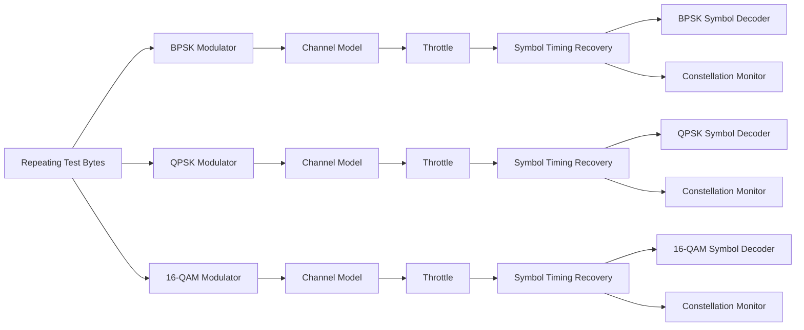
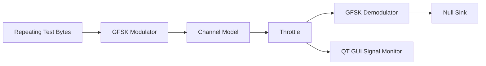
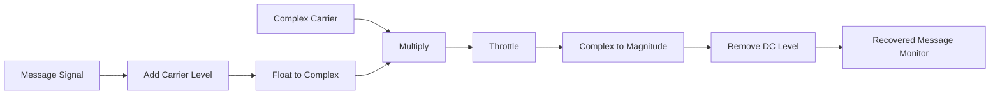
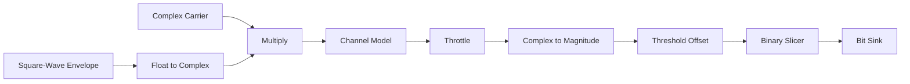

# SDR Modulation & Demodulation Toolkit

  <strong>GNU Radio Companion experiments for digital modulation, demodulation, and IQ signal visualization</strong> 
  GNU Radio 3.10 · DSP · BPSK · QPSK · 16-QAM · GFSK · AM · ASK/OOK

  
  
  

## Overview

This repository contains self-contained GNU Radio Companion (.grc) experiments for learning modulation and demodulation from synthetic signals. The flowgraphs demonstrate baseband signal generation, constellation diagrams, channel-noise effects, envelope detection, and symbol/bit decisions.

No SDR hardware or external input files are required by the included flowgraphs. Start with noise set to 0.0 and introduce channel noise only after the baseline simulation is working.

## Included Flowgraphs

| Flowgraph | What it demonstrates |
|---|---|
| `flowgraphs/Digital_Modulation_Comparison.grc` | Parallel BPSK, QPSK and 16-QAM branches with channel models, symbol timing recovery, symbol decoding and constellation monitoring |
| `flowgraphs/GFSK_Mod_Demod_Lab.grc` | GFSK modulation, simulated channel and GFSK demodulation |
| `flowgraphs/AM_Modulation_Demodulation.grc` | AM signal generation, envelope detection and recovered-message visualization |
| `flowgraphs/ASK_OOK_Mod_Demod.grc` | ASK/OOK signal generation, envelope detection and threshold-based decisions |

## System Architecture

### 1. Digital Modulation Comparison

### 2. GFSK Modulation and Demodulation

### 3. AM Envelope Detection

### 4. ASK/OOK

## Main Parameters

| Parameter | Initial value | Purpose |
|---|---:|---|
| `fs` | `1e6` for digital/GFSK, `48000` for AM/ASK | Sample rate |
| `sps` | `4` | Samples per symbol for PSK/QAM and GFSK |
| `rolloff` | `0.35` | RRC roll-off factor |
| `noise` | `0.0` | Channel Model noise voltage |
| `freq_offset` | `0.0` | Initial frequency offset |
| `epsilon` | `1.0` | Initial sample-rate ratio |

The Channel Model noise parameter is not an SNR value in dB. Quantitative SNR and BER results require separate measurement and analysis.

## Requirements

- GNU Radio Companion 3.10.x
- GNU Radio Digital, Analog, Blocks, Filter and Qt GUI components
- A compatible GNU Radio environment, such as Radioconda on Windows

The included flowgraphs do not require custom Python scripts or external data files to launch.

## How to Run

1. Download or clone this repository.
2. Open GNU Radio Companion from the environment in which GNU Radio is installed.
3. Open a `.grc` file from the `flowgraphs/` directory.
4. Start with zero channel noise.
5. Click Run and observe the signal and GUI output.
6. Stop the simulation, change one parameter at a time, and repeat the experiment.

Run each flowgraph independently. If a block is unavailable, check the active GNU Radio installation and version compatibility.

## What to Observe

- **BPSK:** two ideal constellation points and one bit per symbol.
- **QPSK:** four ideal constellation points and two bits per symbol.
- **16-QAM:** sixteen ideal constellation points and four bits per symbol.
- **GFSK:** information represented by controlled frequency variation.
- **AM:** envelope variation and recovery of the original message.
- **ASK/OOK:** two amplitude states and threshold-based decisions.

## Current Limitations

- The digital comparison flowgraph does not calculate BER or reconstruct complete byte frames.
- The GFSK demodulated bit stream currently terminates at a sink; source-to-receiver bit comparison is not implemented.
- The AM experiment is a software simulation, not a physical RF receiver.
- The ASK/OOK experiment does not implement packet framing, synchronization, or BER calculation.
- No over-the-air transmission, operational telemetry reception, or hardware measurements are performed.

## Future Improvements

- Add BER-versus-SNR measurements using aligned transmit and receive bitstreams.
- Implement packet framing, frame synchronization and CRC validation.
- Add result logging and reproducible performance plots.
- Save screenshots from actual GNU Radio runs in a `screenshots/` directory.

## Author

**Mohit Sharma**  
B.Tech Electrical Engineering · Aligarh Muslim University

Interests: Digital Signal Processing, SDR, RF Communication, Radar and Aerospace Sensing.

---

  <i>Exploring communication systems through block-level signal processing and repeatable simulations.</i>

